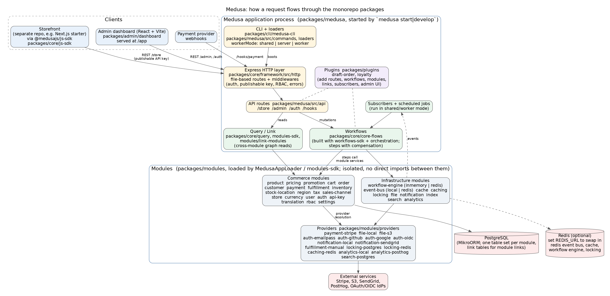

# Medusa monorepo architecture

This page describes how the code on `develop` is organized and how a Medusa application built from these packages handles a request. For product-level concepts (modules, workflows, links, Query), see the [architecture page in the docs](https://docs.medusajs.com/learn/introduction/architecture); its source is `www/apps/book/app/learn/introduction/architecture/page.mdx`.

The diagram source is [`diagrams/architecture.dot`](diagrams/architecture.dot) (Graphviz). After editing it, run `docs/diagrams/render.sh` to regenerate `architecture.png` and `architecture.svg`.

## Repository layout

| Path                                                                                                 | What lives there                                                                                                                                                                                                                 |
| ---------------------------------------------------------------------------------------------------- | -------------------------------------------------------------------------------------------------------------------------------------------------------------------------------------------------------------------------------- |
| `packages/medusa`                                                                                    | `@medusajs/medusa`: the application package. API routes (`src/api`), CLI commands (`src/commands`), loaders (`src/loaders`), core subscribers, and re-exports of every module under `@medusajs/medusa/<module>` (`src/modules`). |
| `packages/core/framework`                                                                            | `@medusajs/framework`: config loading (`medusa-config`), the Awilix container, Postgres connection, Express HTTP layer and middlewares, `MedusaAppLoader`, and the loaders for links, workflows, subscribers and jobs.           |
| `packages/core/modules-sdk`                                                                          | Module registration, boot, migrations, and the remote query / joiner used by Query.                                                                                                                                              |
| `packages/core/orchestration`, `packages/core/workflows-sdk`                                         | The transaction orchestrator and the `createWorkflow` / `createStep` composition API.                                                                                                                                            |
| `packages/core/core-flows`                                                                           | The built-in workflows and steps (cart, order, payment, product, and so on) that API routes run.                                                                                                                                 |
| `packages/core/query`                                                                                | Query: graph reads across modules and their links.                                                                                                                                                                               |
| `packages/core/types`, `packages/core/utils`                                                         | Shared TypeScript types (including `HttpTypes`) and utilities (`MedusaService`, DML, `defineConfig`, `Modules`).                                                                                                                 |
| `packages/core/js-sdk`                                                                               | `@medusajs/js-sdk`, the client used by the admin dashboard and storefronts.                                                                                                                                                      |
| `packages/core/instantsearch-adapter`                                                                | Adapter between InstantSearch UIs and the Search module.                                                                                                                                                                         |
| `packages/modules/*`                                                                                 | Commerce and infrastructure modules, each its own package with models, services, migrations and tests. `link-modules` stores module links.                                                                                       |
| `packages/modules/providers/*`                                                                       | Provider implementations plugged into modules (payment, file, auth, notification, fulfillment, locking, caching, analytics, search).                                                                                             |
| `packages/plugins/*`                                                                                 | First-party plugins: `draft-order` (admin UI) and `loyalty` (API routes, workflows, a module, links, subscribers, jobs, admin UI).                                                                                               |
| `packages/admin/*`                                                                                   | `dashboard` (React + Vite admin app), `admin-sdk` (extension API), `admin-shared`, `admin-bundler` and `admin-vite-plugin` (build the dashboard together with plugin and project extensions).                                    |
| `packages/cli/*`                                                                                     | `medusa-cli` (the `medusa` binary), `create-medusa-app`, `oas` (OpenAPI generation) and `http-types-generator`.                                                                                                                  |
| `packages/design-system/*`                                                                           | `ui`, `ui-preset`, `icons` and `toolbox` (Medusa UI).                                                                                                                                                                            |
| `packages/medusa-test-utils`, `packages/eslint-plugin`, `packages/medusa-telemetry`, `packages/deps` | Test runners for module and HTTP integration tests, lint rules, telemetry, and shared dependency re-exports.                                                                                                                     |
| `integration-tests/`                                                                                 | Full-stack HTTP and module integration suites that run against Postgres (and Redis where needed).                                                                                                                                |
| `www/`                                                                                               | The documentation workspace: Next.js apps in `www/apps` (book, resources, api-reference, ui, user-guide, cloud) and shared packages in `www/packages`. It has its own `yarn.lock`.                                               |

## How an application boots

`medusa start` (and `medusa develop`) are implemented in `packages/medusa/src/commands` and call the loaders in `packages/medusa/src/loaders/index.ts`:

1. `initializeContainer` loads feature flags, `medusa-config`, and policies, registers the logger, and opens the Postgres connection.
2. Plugins listed in the config are resolved and their modules merged into the config. Links from plugins are loaded, then search index definitions.
3. `MedusaAppLoader` (framework) uses modules-sdk to load every configured module and provider, build the link modules, and expose Query.
4. Workflows from plugins are registered. Subscribers are always loaded; scheduled jobs only when `workerMode` is `shared` or `worker`.
5. Unless `workerMode` is `worker`, the Express app is set up: a request scope per request, the framework's route and middleware loaders, the admin dashboard (served at `/app` unless disabled), and the API routes from `packages/medusa/src/api` plus each plugin's `api` directory.

`workerMode` comes from `projectConfig.workerMode` or `MEDUSA_WORKER_MODE` and defaults to `shared`. `medusa start --cluster` forks processes and can split them into server and worker instances.

## How a request is handled

- Routes are file-based (`route.ts` exporting `GET`, `POST`, `DELETE`, ...) under `/store`, `/admin`, `/auth`, `/hooks` (payment webhooks) and `/cloud`. Each area has a `middlewares.ts` that applies validation, authentication, publishable API key checks (store), permission checks (admin RBAC) and query config.
- Writes run a workflow from `@medusajs/core-flows` with `req.scope`. Each step resolves a module service from the container, and failed workflows run step compensation in reverse. The workflow engine module (in-memory or Redis) stores executions and runs async steps.
- Reads mostly use Query (`ContainerRegistrationKeys.QUERY`), which fetches data across modules and follows module links without modules importing each other.
- Modules emit events through the event bus module; subscribers (core ones in `packages/medusa/src/subscribers`, plus plugin and project ones) react to them, often by running more workflows.

## Data and infrastructure

- Every data module uses MikroORM on the same PostgreSQL database, with its own tables and migrations (`medusa db:migrate` runs them, plus link table migrations).
- Without `REDIS_URL`, the app uses in-process defaults (local event bus, in-memory cache and workflow engine). `defineConfig` swaps in the Redis event bus, cache, workflow engine and the Redis locking provider when `REDIS_URL` is set.
- External services are reached only through providers, for example Stripe (`payment-stripe`), S3 (`file-s3`), SendGrid (`notification-sendgrid`) and PostHog (`analytics-posthog`).

## Build and test

Yarn 3 workspaces with Turbo (`turbo.json`). `yarn build` builds every package (and `build:plugin` for plugins); `yarn test` runs unit tests (Jest for backend packages, Vitest for `admin/dashboard` and `design-system/ui`). Integration suites are listed in [`CLAUDE.md`](../CLAUDE.md) and need Postgres (`DB_HOST`, `DB_PORT`, `DB_USERNAME`, `DB_PASSWORD`).
